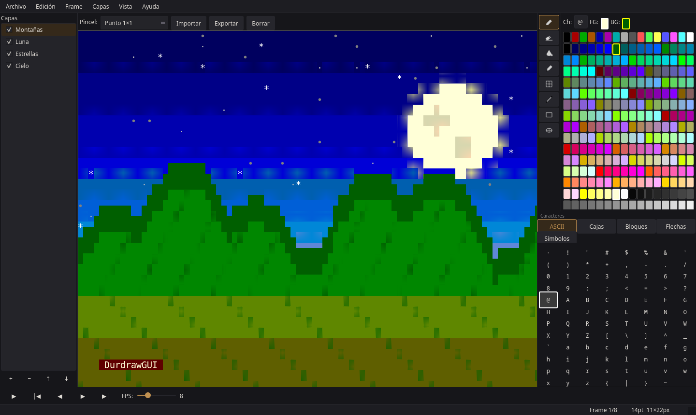
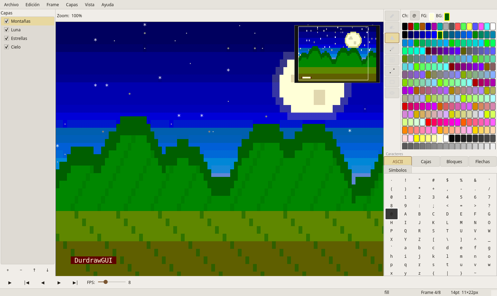
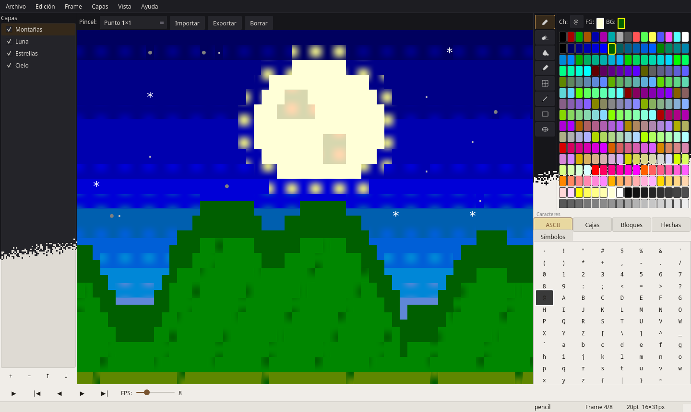

<div align="center">

# DurdrawGUI

**Editor de arte ASCII y ANSI con capas y animación, con interfaz gráfica nativa.**


</div>

---

## Qué es

DurdrawGUI es un editor de arte en texto —ASCII, ANSI y Unicode— con una interfaz al estilo de
los editores de *pixel art*: herramientas de dibujo, capas y animación por fotogramas. Usa el
motor de archivos y paletas de [durdraw](https://github.com/cmang/durdraw), de Sam Foster, y le
añade una interfaz gráfica completa construida con Qt 6, nativa en Wayland y X11.

<p align="center">
  
  &nbsp;
  
</p>
<p align="center">
  
</p>

<p align="center"><sub>Arte de demostración generado por <code>tools/capturas/capturas.py</code>, que también regenera las capturas.</sub></p>

## Funciones principales

- Lápiz, borrador, relleno, cuentagotas, selección, línea, rectángulo y elipse.
- Pinceles predefinidos y de usuario, con interpolación al arrastrar.
- Modos de 16 y 256 colores.
- Panel de caracteres: bloques Unicode, el juego CP-437 completo, flechas y símbolos.
- Capas, animación por fotogramas y deshacer ilimitado por sesión.
- Exportación a ANSI, `.dur`, PNG, GIF animado y MP4.
- Zoom anclado al cursor, atajos de teclado configurables y modo de dibujo solo con teclado.
- Botones de ratón y de tableta gráfica configurables.
- Reproducción fluida a 30 FPS incluso en lienzos de 240×67 con 10 capas
  ([cifras](docs/pendientes/rust-modulos.md)).

## Tecnologías

| Capa | Tecnología |
|---|---|
| Interfaz | PySide6 (Qt 6) |
| Motor | durdraw (BSD-3-Clause), incluido en `core/durdraw/` |
| Imagen | Pillow, NumPy e imageio |
| Empaquetado | AppImage |

## Puesta en marcha

```bash
pip install PySide6 Pillow numpy
python main.py
python -m pytest            # pruebas
```

Requiere Python ≥ 3.11. La compilación del AppImage está en [`BUILD.md`](BUILD.md).

## Documentación

[`docs/guia.md`](docs/guia.md): todas las funciones, atajos de teclado, archivos de usuario y
pruebas. Las decisiones de arquitectura (ADR) están en [`docs/decisiones/`](docs/decisiones/).

## Licencia

Código bajo **GPL-3.0-or-later** ([`LICENSE`](LICENSE)). Los componentes de terceros y sus licencias
están en [`NOTICE`](NOTICE). El nombre y la identidad visual no forman parte de la licencia: ver
[`TRADEMARKS.md`](TRADEMARKS.md). Para aportar, [`CONTRIBUTING.md`](CONTRIBUTING.md).

## Apoyo

Este proyecto forma parte del trabajo de **NoctiVulp**: herramientas para Linux y Android,
publicadas como software libre. Las compilaciones oficiales y las novedades salen en Patreon.

<p align="center">
  <a href="https://www.patreon.com/cw/NoctiVulp"></a>
</p>

---

<p align="center"><sub>© 2026 NoctiVulp · <b>Powered by AI</b> — desarrollado con la asistencia de Claude, de Anthropic.</sub></p>
